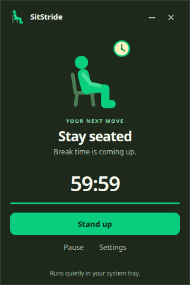
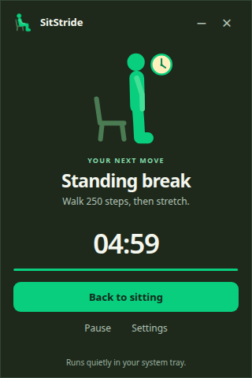
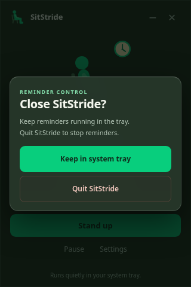

# SitStride — stand up reminder for Windows

SitStride is a Windows system-tray break timer that reminds you to stand up, change posture, and take a short walking break. An animated mascot accompanies a customizable sitting timer and standing-break timer, so you can keep reminders nearby without leaving the window open.

**Version 1.0.7 is an unsigned, x64-only test build targeting Windows 10/11.** Static/source checks and packaged-Linux checks passed in the supplied QA evidence, but the installer and native Windows behavior have **not** been tested on Windows. The installer is attached to the **unpublished draft v1.0.7 release** in this private repository; it is not a public download or a published release.

## Install the Windows application

1. **Check your system:** use 64-bit (x64) Windows 10 or 11. There is no 32-bit (x86) installer or native ARM64 build. Electron 45 does not provide a Windows x86 runtime.
2. **Stop the old VBS reminder before installing** to avoid duplicate reminders. Stop only the reminder's script process if you can identify it. Do not blindly run the legacy `Stop_Timing.vbs`: it terminates **all** `wscript.exe` processes, including unrelated scripts.
3. Sign in to GitHub with an account allowed to access this private repository and its draft releases. Open [Releases](https://github.com/winsongohhhh/sitstride/releases), select the draft **SitStride 1.0.7**, and download **`SitStride-Setup-1.0.7-x64.exe`** from **Assets**. If you cannot see the draft, ask the repository owner for access; the release remains unpublished.
4. Open the downloaded `.exe` and follow the setup prompts. **The installer is unsigned**, so Windows may show a **SmartScreen** or unknown-publisher warning. Only continue if you trust this repository and the downloaded file. If SmartScreen offers **More info → Run anyway**, use it only after verifying the source; do not disable Windows security protections.
5. Launch **SitStride** after setup, open **Settings**, and choose your sitting and standing intervals. Use **Stand up** and **Back to sitting** to change phases. The tray icon may be in Windows' hidden-icons menu.
6. To leave reminders running, choose **Keep in system tray** in the close dialog. To stop the application, choose **Quit SitStride**.

**Testing warning:** installation/uninstallation and native Windows behavior—including tray controls, sound, startup, display placement, and DPI—have not been tested on Windows. Treat this as a test candidate, not a Windows-validated production release. Node.js and npm are not needed to use the installer.

## Application screenshots

These genuine SitStride 1.0.7 screenshots were captured from the running packaged Linux app. They are not evidence of native Windows testing.



**Sitting:** the countdown to your next standing break.



**Standing:** a five-minute break with a suggestion to walk 250 steps.



SitStride 1.0.7's close dialog, captured during packaged-Linux runtime QA. This screenshot is not evidence of native Windows testing.

## A gentle reminder to leave your chair

- Start with a **60-minute sitting interval** and a **5-minute standing interval**, or choose sitting intervals of 1–240 minutes and standing intervals of 1–60 minutes.
- Get a **“Time to stand up”** popup with a suggestion to walk 250 steps. This is a suggestion, **not step tracking**.
- Use **Stand up** and **Back to sitting** to change phases, with an animated mascot and a reduced-motion option.
- Pause and resume the countdown, or snooze a due sitting reminder for five minutes.
- Keep reminders running in the system tray, with optional reminder sound and run-on-startup settings.
- Save settings locally. The app has no telemetry, automatic updater, or application network requests.

SitStride is a posture reminder and sitting-break timer, not a medical tool. It does not measure activity or guarantee health outcomes.

## How it works

Launch the app to begin a sitting countdown. At the reminder, choose **Stand up** to start a standing break. After the standing countdown ends, the app waits for you to choose **Back to sitting** before starting the next sitting interval.

Click **−** to hide the window silently while the timer continues. Click the tray icon to show or hide it, or right-click for posture actions, Pause/Resume, Settings, and Quit. Windows may place the tray icon in its hidden-icons menu.

Click **×** for the close dialog: **Keep in system tray** leaves reminders running; **Quit SitStride** exits. Escape dismisses the dialog. Interval changes apply to the next posture phase. Sleep time counts toward the active interval, and relaunching starts a new sitting countdown.

## Build and run from source

Use Node.js 22.12 or newer (Node.js 24 recommended) and npm:

```sh
npm ci
npm test
npm start
```

To build the Windows x64 installer:

```sh
npm run dist:win
```

The configured output is `release/1.0.7/SitStride-Setup-1.0.7-x64.exe`. This file is generated by the build and is **not included in this source repository**. Building on Windows is recommended; Linux cross-builds need Wine and an X display or `xvfb-run`.

Electron 45 does not provide a Windows x86 runtime, so **32-bit Windows is unsupported**. No native ARM64 build is included. `npm run dist:win:x86` deliberately reports the unsupported architecture instead of attempting a build.

## What changed in 1.0.7

Saved **Reduce motion** now applies to the close dialog as well as the mascot. Either the saved setting or the operating-system preference removes spatial dialog movement, using short opacity-only fades instead. Live OS preference changes are respected.

The close-dialog choices preserve 44px-high targets, press feedback, visible keyboard focus, focus containment, and Escape dismissal with focus restoration. The 44px statement applies **only to the close-dialog choices**, not every app control.

See [draft release notes](RELEASE_NOTES_1.0.7.md) and the [original source README](docs/README-source-1.0.7.md) for detailed history.

## Testing status and limitations

The supplied QA covers source/static checks, timer and main-process regression tests, renderer checks, and packaged Electron behavior on Linux. It does **not** establish native Windows compatibility. Windows installation/uninstallation, tray behavior, reminder sound, startup registration, multi-monitor placement, and DPI behavior still need Windows smoke testing.

The Windows installer is **unsigned** and may trigger SmartScreen or unknown-publisher warnings. Do not bypass warnings for a copy you do not trust. Treat 1.0.7 as a test candidate, not a Windows-validated production release.

The original VBS scripts are retained only for provenance. Stop an old VBS reminder before trying SitStride to avoid duplicate reminders. SitStride does not run `Stop_Timing.vbs`; that legacy script terminates all `wscript.exe` processes.

## Project layout

- `app/`: Electron main process, timer, renderer, and bundled assets.
- `tests/`: automated timer and main-process tests.
- `qa/`: supplied versioned QA evidence and test helpers; some reference the original build environment and are not portable commands.
- `original/`: original StandUp Windows scripts and license.
- `docs/README-source-1.0.7.md`: unchanged documentation from the source ZIP; referenced release artifacts are not necessarily included here.

## Credits and license

Original StandUp Windows script: Copyright (c) 2026 Flora Wu, MIT License. Original scripts and notices are preserved in `original/`, and the license is retained in [app/LICENSE](app/LICENSE). The supplied project documentation states that the new application code is also MIT-licensed. Bundled app and tray artwork is in `app/assets/`.

## Sponsors


## ☕ Support My Work

If you find my projects useful, consider
supporting their development!

[]([https://ko-fi.com/winsongohhhh]))

